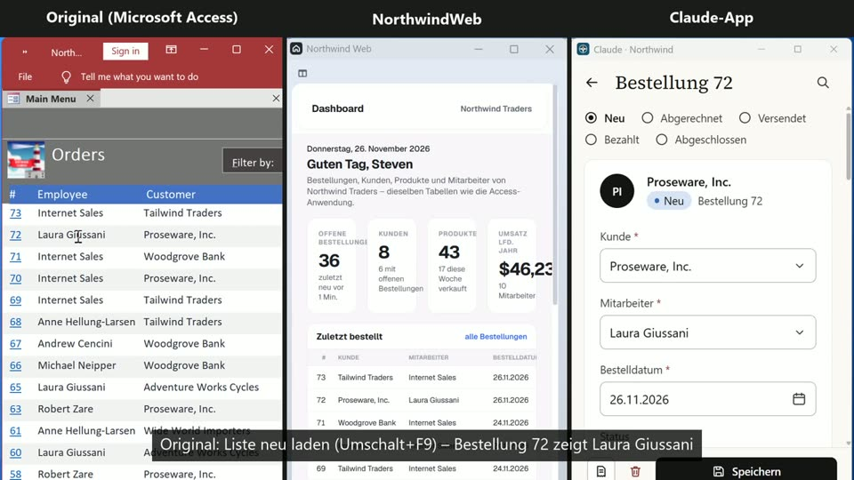

<!-- SPDX-License-Identifier: AGPL-3.0-or-later -->

<b>Deutsch</b> · <a href="README.en.md">English</a>

<h1 align="center">
  <picture>
    <source media="(prefers-color-scheme: dark)" srcset="docs/media/wordmark-dark.svg">
    
  </picture>
</h1>

<b>Alte Software verstehen und mit KI nachbauen: als moderne Webanwendung, als Archiv-Klon oder als Claude-App. Ohne Quellcode.</b>

  
  
  
  
  
  
  

 ▶️ <a href="https://eqlmaker.org/de/#claude-app">Video auf eqlmaker.org</a>: Original (Microsoft Access) | Web-Version | Claude-App – eine Änderung, drei Oberflächen

> [!TIP]
> **Neu: Claude-Apps aus Altanwendungen.** Neben Webanwendung und Archiv-Klon gibt es ein drittes Ergebnis: eine Claude-App, die direkt in Claude Desktop läuft und lokal mit EQLServer auf denselben Daten arbeitet. Jede Änderung zeigt vorher eine Vorschau und wird in Claude bestätigt. Bisher gibt es sie als Beispiel für Northwind (Access-Vorlage), weitere folgen. Sie entstand wie die übrigen Beispiele von einem KI-Agenten mit demselben Verfahren; EQLMaker 0.2.0 hat dafür noch keinen eigenen Befehl. Die App ist privat und braucht Claude Desktop; „Als App installieren“ ist dort eine Beta-Funktion.

<!-- docs/media/demo.gif : die Demo-Animation folgt mit der ersten Veröffentlichung (erzeugt von scripts/demo/make-demo.ps1) -->

**EQLMaker ist das offene Werkzeug, um Altanwendungen mit KI abzulösen.** Es **schaut zu**, wenn das alte Programm bedient wird, **misst**, was es dabei in der Datenbank tut, auf derselben Zeitachse, **versteht** es aus Handbuch, Video mit Erklärung und den Dateien der Anwendung, **bereitet den Nachbau** für einen KI-Assistenten vor und **belegt** ihn: Vergleichstests zeigen, ob der Nachbau dasselbe zeigt und dieselben Daten ändert wie das Original.

Die Nachbau-Schritte sind geführt, nicht vollautomatisch: Ein KI-Assistent baut, EQLMaker bereitet seine Arbeit vor und prüft das Ergebnis.

<!-- status:begin release -->
> [!NOTE]
> **Stand:** Version 0.2.0 wurde am 2026-11-25 veröffentlicht. Das Windows-Paket liegt auf der [Release-Seite](https://github.com/robertbinsack/eqlmaker/releases/latest); die Tabelle unter [Funktionen](README.md#funktionen) nennt die Tests dahinter. Siehe [Schnellstart](README.md#schnellstart).
<!-- status:end -->

---

## Das Problem

Viele Betriebe, Vereine und Verwaltungen arbeiten mit alter Software, deren Hersteller es nicht mehr gibt und deren Quellcode fehlt. Sie bekommt keine Sicherheitsupdates mehr und wird zum Risiko. Die Ablösung scheitert meist nicht an der Technik, sondern daran, dass **niemand mehr genau weiß, was das Programm alles tut**.

## Was EQLMaker macht

EQLMaker sammelt das Wissen, das in einer laufenden Anwendung steckt, ohne ihren Quellcode zu brauchen:

- Jemand bedient das alte Programm wie gewohnt. EQLMaker **zeichnet auf**, was auf dem Bildschirm geschieht, und **misst** gleichzeitig, welche Daten die Anwendung in der Datenbank liest und ändert.
- **Die KI bedient die Anwendung auch selbst.** Je nach Prompt bedient die KI die Anwendung selbst, um die Oberfläche und die Bedienung vollständig zu katalogisieren. Anwender können den Katalog anschließend selbst ergänzen.
- Dazu kommen das **Handbuch** und auf Wunsch ein **Video mit gesprochener Erklärung**.
- Wer die **Dateien der Anwendung** hat, kann sie lesen lassen: Der eingebaute Reader für PowerBuilder-Bibliotheken listet Menüs, Fenster, Beschriftungen und jede SQL-Anweisung, auch von Funktionen, die niemand aufgenommen hat. Reader für andere Dateiarten werden auf dieselbe Weise angeschlossen.
- Alles landet auf einer gemeinsamen **Zeitachse**: dieser Klick, diese Maske, diese Änderung in der Datenbank, dieser Satz im Handbuch.
- Aus der Zeitachse entsteht eine **Spezifikation**. Mit ihr baut ein angeschlossener KI-Assistent die Anwendung als moderne Webanwendung nach. EQLMaker liefert Vorlage und Anleitung und prüft danach mit **Vergleichstests**, ob der Nachbau dasselbe zeigt und dieselben Daten ändert wie das Original.

## So funktioniert es

~~~mermaid
flowchart LR
    subgraph IN["1 · Was hineingeht"]
        A["Bedienung aufzeichnen"]
        B["Datenbank- änderungen messen"]
        C["Handbuch einlesen"]
        D["Video mit Zeitstempel & Ton"]
    end
    subgraph MAKE["2 · Was EQLMaker daraus macht"]
        E["Zeitachse"]
        F["Spezifikation"]
        G["Nachbau (Migration / Archiv)"]
    end
    subgraph PROOF["3 · Der Beleg"]
        H["Vergleichstests"]
        I["Vergleichsvideo"]
    end
    A --> E
    B --> E
    C --> E
    D --> E
    E --> F --> G --> H --> I
~~~

| Stufe | Schritt | Was passiert | Befehl |
|---|---|---|---|
| 1 | Bedienung beobachten | Bildschirmvideo und jede Bedienhandlung mit Zeit, Fenster und Steuerelement – für Windows-Programme und Browser-Anwendungen | `record` |
| 1 | Datenänderungen messen | Anweisungen, Parameter, Transaktionen und geänderte Zeilen mit Bordmitteln von PostgreSQL. Gemessen, nicht geraten. | `record` |
| 1 | Handbuch einlesen | PDF, HTML, DOCX, Text oder Markdown; Kapitel werden mit den Masken verknüpft | `manual` |
| 1 | Video mit Zeitstempel und Ton | Eine Leiste zeigt Datum und Uhrzeit mit Millisekunden über allen Fenstern; Aufnahme mit beliebigem Bildschirmrekorder; Transkript offline per Whisper | `video-import` |
| 2 | Zeitachse | Zeitstempel im Bild wird mit den Zeiten der Datenbankänderungen abgeglichen | `correlate` |
| 2 | Spezifikation | Masken, Abfragen, gelesene und geschriebene Tabellen, Verweise ins Handbuch, Hinweise aus dem Video | `spec` |
| 2 | Nachbau | Moderne Webanwendung (Migration) oder nur lesender Klon (Archiv) – geführte Schritte für den KI-Assistenten | `generate` · `clone` · `enrich` |
| 3 | Vergleichstests | Bildvergleich der Masken und Vergleich der gemessenen Datenbankänderungen; der Bericht zeigt Abweichungen | `verify` |
| 3 | Vergleichsvideo | Original und Nachbau auf einer Zeitachse nebeneinander, mit Player | `video` |

Alle Schritte gibt es auch als Werkzeuge eines **MCP-Servers**.

## Zwei Modi

| | Modus 1 · Migration | Modus 2 · Archiv |
|---|---|---|
| **Ergebnis** | Neue Oberfläche, die liest und schreibt | 1:1-Klon im Browser, nur lesend |
| **Basis** | Moderne Webanwendung nach Vorlage, auf denselben Tabellen wie das Original | Die Masken des Originals; Speichern, Buchen und Neuanlage sichtbar, aber ausgegraut |
| **Altanwendung** | Kann währenddessen weiterlaufen | Kann abgeschaltet werden |
| **Für wen** | Wer seine Software weiter nutzen und weiterentwickeln will | Wer ein Altsystem abschalten und seine Daten weiter einsehen muss |

## Beispiele: Altanwendung und Nachbau nebeneinander

> [!IMPORTANT]
> Diese Proofs of Concept entstanden mit demselben Verfahren auf EQLServer, je Projekt von einem KI-Agenten, **bevor EQLMaker ein eigenes Programm war**. EQLMaker v0.1 hat sie nicht erzeugt. Sie zeigen, was das Verfahren leistet.

| Anwendung | Technik | KI-Erstellungszeit neue Oberfläche | Abgedeckt |
|---|---|---|---|
| Hausverwaltung | PowerBuilder 6.5 · SQL Anywhere | 24,5 Min. | 70 / 70 Menüfunktionen (100 %) |
| Warenwirtschaft | Delphi · Advantage | 16,9 Min. + 5 Std. 17 Min. Ausbau | 398 / 494 Menüfunktionen (81 %) |
| Informix-Beispielanwendung | ASP.NET · Informix | 7,7 Min. | 8 / 8 Seiten und Aktionen (100 %) |
| InvoicePlane (Open Source) | PHP · MySQL/MariaDB | 41 Min. | 81 / 82 GUI-Funktionen (99 %) |
| TurboCASH (Open Source) | Delphi · Firebird | 42 Min. | 228 / 266 Menüfunktionen (86 %) |
| Northwind (Access-Vorlage) | Microsoft Access · ODBC | 45 Min. | 58 / 58 GUI-Funktionen (100 %) |
| Contoso University (Microsoft-Beispiel) | ASP.NET Core · SQL Server | 14 Min. | 32 / 32 GUI-Funktionen (100 %) |
| Dolibarr ERP/CRM (Open Source) | PHP · PostgreSQL | 3 Std. 09 Min. | 81 / 93 GUI-Funktionen (87 %) |

▶️ **Videos (Original und Nachbau nebeneinander):** [eqlmaker.org](https://eqlmaker.org/de/) – die Demo-Videos hat die KI selbständig bedient; daraus entstanden die Apps. Auf eqlserver.de sind sie mit [`eqlmaker narrate`](docs/de/narration.md) vertont, auf Deutsch und auf Englisch.

Die Anwendungen stammen von Drittherstellern oder sind quelloffen. Produkt- und Herstellernamen fremder Programme sind anonymisiert.

## Funktionen

### Version 0.2

<!-- status:begin summary -->
22 von 22 Funktionen der Version 0.2 sind verfügbar und getestet, 0 in Entwicklung. Die Spalte „Test“ nennt die Tests des Repositorys, die jede Funktion belegen.
<!-- status:end -->

<!-- status:begin features -->
| Funktion | Beschreibung | Stand | Test |
|---|---|---|---|
| Bedienung aufzeichnen | Windows-Programme und Browser-Anwendungen: Bildschirmvideo, dazu jede Bedienhandlung mit Zeit, Fenster und Steuerelement, wenn EQLMaker das Programm bedient (Szenariodatei oder MCP-Client); Video und Datenbankereignisse auch, während ein Mensch von Hand arbeitet | verfügbar · getestet | `PipelineTests.SampleEndToEndOnPlainPostgres` `RecordCliTests.StartAndStopWhileSomeoneElseWorks` `RecordCliTests.StartTakesLoginsAndDatabaseFromTheCommandLine` |
| Gemessene Datenbankänderungen | Anweisungen, Parameter, Transaktionen und geänderte Zeilen mit Bordmitteln von PostgreSQL – nichts wird serverweit umgestellt, kein Neustart; geänderte Zeilen auch von Servern ohne das Modul test_decoding (über pgoutput) | verfügbar · getestet | `PostgresSourceTests.CapturesStatementsParametersErrorsAndChangedRows` `PostgresSourceTests.RoleCaptureAndResetOfAnAbortedCapture` `LogParserTests.DefaultPrefixStatementsParametersErrors` `TestDecodingTests.InsertUpdateDeleteWithQuotingAndTypes` `PgOutputTests.MessagesAreReadAsTransactionsWithRows` `PgOutputTests.CapturesChangedRowsThroughPgoutputAndCleansUp` |
| Offenes Ereignisformat | Datenbankzugriffe als JSON Lines, dokumentiert, Version 0.1 | verfügbar · getestet | `EventFormatTests.FileRoundTripWithAllFields` `EventFormatTests.NewerMajorVersionIsRefused` `EventFormatTests.SortIsStable` |
| Handbuch einlesen | PDF, HTML, DOCX, Text oder Markdown; Kapitel werden mit Masken verknüpft | verfügbar · getestet | `ManualTests.PdfCompressedWithCharacterMapAndObjectStream` `ManualTests.PdfPrintedByABrowser` `ManualTests.Docx` `ManualTests.Html` `ManualTests.MarkdownAndTheSampleHandbook` `ManualTests.PlainText` `ManualTests.RunWritesIntoTheProjectAndSpecLinksIt` |
| Zeitstempel-Leiste | Kleines Programm, das Datum und Uhrzeit mit Millisekunden über allen Fenstern zeigt | verfügbar · getestet | `TimecodeTests.OverlayProgramRendersTheSameStrip` `TimecodeTests.ScaledAndCompressedFramesAreRead` `TimecodeTests.DamagedPatternFallsBackToTheDigits` |
| Video mit Ton nachreichen | Zeitstempel wird aus dem Bild gelesen und mit den Datenbankänderungen abgeglichen | verfügbar · getestet | `VideoImportTests.ImportAt15FramesPerSecond` `VideoImportTests.ImportAt30FramesPerSecond` `VideoImportTests.ImportAt60FramesPerSecond` `ClockMapTests.CutsAreFoundAndMappedOnBothSides` `ClockMapTests.OffsetOfAWrongClockIsEstimated` |
| Transkript mit Whisper | Spracherkennung über whisper.cpp, vollständig offline. Das Erkennungsprogramm und ein Modell gehören zum Windows-Paket; aus dem Quellcode nennt man ein eigenes `whisper-cli.exe` in der Konfiguration. Der Sprachtest läuft dort, wo ein Erkennungsprogramm vorhanden ist; der Test des Pakets transkribiert eine englische und eine deutsche Probe | verfügbar · getestet | `SpeechTests.SpokenSentenceIsTranscribed` `VideoImportTests.TranscriptFormatsAreRead` |
| Zeitachse und Spezifikation | Klick, Maske, Anweisung und Transaktion auf einer Zeitachse; daraus Masken, Abfragen und Tabellen nach festen Regeln | verfügbar · getestet | `TimelineTests.EventsGoToTheActionBeforeThem` `TimelineTests.TransactionIdsGiveExactTies` `TimelineTests.TransactionsAreTiedByTimeAndTableWithoutIds` `TimelineTests.SameInputGivesSameOutput` `SpecTests.StepsMasksQueriesTablesAndManualLinks` |
| Nachbau als Webanwendung | Geführter Schritt mit Web-Vorlage und Anleitung für einen angeschlossenen KI-Assistenten | verfügbar · getestet | `GuidedTests.GenerateIsAWorkspaceAndInstructionsNotAnApplication` `src/templates/web/test/template.test.js: server: API and files through HTTP with a stand-in pool` |
| Archiv-Klon, nur lesend | Geführter Schritt mit Referenzbildern je Maske | verfügbar · getestet | `GuidedTests.CloneScaffoldShowsTheReferenceAndGreysOutWritingControls` |
| Befunde aus dem Video übernehmen | Geführter Schritt: Jeder Befund wird als übernommen, abgelehnt oder offen entschieden, mit Bericht | verfügbar · getestet | `GuidedTests.EnrichRecordsDecisionsAndReportsEveryFinding` |
| Vergleichstests | Bildvergleich und Vergleich der gemessenen Datenbankänderungen zweier Aufnahmen | verfügbar · getestet | `VerifyScreensTests.EqualDifferentToleranceIgnoreAndSize` `VerifyScreensTests.FoldersArePairedByName` `VerifyDbTests.SameChangesWithOtherGeneratedKeysAreEqual` `VerifyDbTests.DeliberateDifferencesAreFound` `VerifyDbTests.MissingStepAndEmptyRecordingsAreNotEqual` `VerifyDbTests.AWrongReferenceIsNotHiddenByTheKeyRule` |
| Vergleichsvideo mit Player | Original und Nachbau auf einer Zeitachse | verfügbar · getestet | `PluginTests.VideoLayoutPluginIsUsedByVideo` `PipelineTests.SampleEndToEndOnPlainPostgres` |
| Vertonung von Demo-Videos | Ein gesprochener Kommentar über einem fertigen Video, Abschnitt für Abschnitt entlang seiner Untertitel-Zeitachse, erzeugt von einem lokalen Fish-Speech-Server mit eigener Stimmreferenz; Clips werden gemessen und eingepasst (höchstens leicht beschleunigt), optionale Hintergrundmusik mit einstellbarer Lautstärke wird unter der Sprache abgesenkt; das Bild bleibt unverändert | verfügbar · getestet | `NarrationTests.NarrateMixesSpeechAndMusicOverTheVideo` `NarrationTests.NarrateRefusesSpeechThatDoesNotFit` `NarrationTests.FitSpeedsUpSlightlyAndReportsWhatToCut` `NarrationTests.DraftCoversTheWholeVideoAndSplitsLongCaptions` |
| MCP-Server und Kommandozeile | Dieselben Schritte als Werkzeuge für jeden MCP-Client und als Befehle | verfügbar · getestet | `McpTests.ProtocolToolsAndPrompts` `PipelineTests.CommandLineReportsUnknownCommandsAndMissingArguments` |
| Plugin-Schnittstellen | Für Ereignisquellen, Reader, Web-Vorlagen, Klon-Renderer und Videolayouts, dokumentiert | verfügbar · getestet | `PluginTests.ExamplesAreValidAndOfEveryType` `PluginTests.SourcePluginDeliversEventsThroughTheSameInterface` `PluginTests.WebTemplatePluginIsUsedByGenerate` `PluginTests.CloneRendererPluginIsUsedByClone` `PluginTests.VideoLayoutPluginIsUsedByVideo` `PluginTests.BrokenManifestsAreRefusedWithTheReason` `ReaderTests.ReaderPluginWritesTheSameFormatAndIsFoundByFileExtension` `ReaderTests.ReaderPluginNeedsACommandAndAValidResult` |
| Beispielanwendung mit Ende-zu-Ende-Lauf | Eine eigene Beispielanwendung als Windows-Programm und im Browser; `eqlmaker sample` durchläuft den ganzen Ablauf auf reinem PostgreSQL und findet die absichtlichen Fehler | verfügbar · getestet | `PipelineTests.SampleEndToEndOnPlainPostgres` `examples/sample-app/web/test/http.test.js: saving an invoice writes invoice, lines, stock movements, stock and counter` `examples/sample-app/web/test/calc.test.js: the deliberate defect changes at least one rounding vector, and only the tax` |
| Deutsch und Englisch | Programme, Dokumentation und Web-Vorlage in beiden Sprachen | verfügbar · getestet | `I18nTests.TranslationsHaveTheSameKeysAndPlaceholders` `I18nTests.GermanIsUsedWhenAskedFor` `I18nTests.EnglishFileIsTheExportOfTheCode` `src/templates/web/test/template.test.js: languages: English and German resources have the same keys` |
| Einrichtung ohne Adminrechte | Eine Batchdatei richtet alles im eigenen Ordner ein: kein Installer, keine Registry, kein Dienst. Getestet mit dem veröffentlichten Paket als Benutzer ohne Adminrechte unter Windows Server 2025; nicht getestet auf einem frischen Windows 10 oder 11. Die Tests des Pakets laufen lokal vor einer Veröffentlichung, nicht in den automatischen Prüfungen des Repositorys | verfügbar · getestet | `scripts/setup/tests/test-setup.ps1: the setup process is not elevated (restricted token, evidence taken inside the run)` `scripts/setup/tests/test-setup.ps1: eqlmaker-setup.cmd -unattended as ordinary user: downloads, default PostgreSQL without psql, self test with speech and logical decoding` `scripts/setup/tests/test-setup.ps1: registry autostart and uninstall keys, PATH, environment, services, firewall rules, scheduled tasks: nothing added, removed or changed by the package` `scripts/setup/tests/test-setup.ps1: remove: after eqlmaker-db-stop.cmd the folders can be deleted completely by the ordinary user` |
| PowerBuilder-Bibliotheken lesen | Eingebauter Reader für die kompilierten Bibliotheken (.pbd, .pbl) von PowerBuilder 5 bis 9, ohne Quellcode: Menüs, Fenster, Beschriftungen, SQL-Anweisungen und Verweise. Das Ergebnis geht in die Spezifikation und zeigt, welche Tabellen keine Aufnahme berührt hat | verfügbar · getestet | `ReaderTests.PowerBuilderReaderReadsObjectsSqlLabelsMenusAndReferences` `ReaderTests.PowerBuilderReaderRefusesUnicodeLibrariesAndOtherFiles` `ReaderTests.FirstLibraryWinsForAnObjectNameThatOccursTwice` `ReaderTests.ReadCommandPicksTheReaderByFileExtensionAndSpecTakesTheResultOver` |
| Anweisungstabelle und alte Szenariodateien | Die Anweisungen einer Aufnahme als Tabelle sql.tsv (das Format, das Werkzeuge zum Abspielen von Anweisungen lesen; T-SQL-Stapel und -Aufrufe als tsql-batch und tsql-rpc); Szenariodateien des früheren Recorders werden umgewandelt; ein Szenario kann eigene Logins und Datenbanken für den Mitschnitt nennen | verfügbar · getestet | `ExportTests.SqlTsvHasTheColumnsKindsAndEscapesOfTheReplayFormat` `ExportTests.ExportSqlCommandWritesTheTableOfAnExistingRecording` `ExportTests.ScenarioOfTheEarlierRecorderIsConverted` `ExportTests.ScenarioCaptureObjectReplacesRolesAndDatabasesOfTheConfiguration` |
| Anwendungen auf anderen Datenbanken | Anwendungen, die SQL Server (TDS) sprechen, werden über EQLServer mitgeschnitten, ein eigenes, optionales Produkt, das in PostgreSQL speichert: Stapel, Aufrufe und geänderte Zeilen auf einer Zeitachse. Getestet mit einem optionalen Ende-zu-Ende-Test gegen einen laufenden EQLServer 1.10.0; die anderen Protokolle sind nicht getestet. EQLMaker braucht EQLServer nicht | verfügbar · getestet | `ServerTests.TdsStatementsAndChangedRowsOfAnApplicationReachTheTimeline` `tests/eqlserver/run-eqlserver-e2e.ps1: changed rows: insert, update and delete of the customer table` `TimelineTests.TransactionsAreTiedAcrossTheNamesOfAServerThatKeepsSeveralDatabasesInOne` |
<!-- status:end -->

„Verfügbar“ heißt: gebaut und durch die genannten Tests dieses Repositorys belegt. Wie eine Funktion dorthin kommt, steht in [CONTRIBUTING.de.md](CONTRIBUTING.de.md); die einzige Quelle dieser Tabelle ist [docs/status.json](docs/status.json).

### Geplant · Vorhaben ab Juni 2027

Ein klar abgegrenztes neues Modul. Bisher gibt es nur das Konzept, keinen Code. Für dieses Vorhaben wird eine Förderung beantragt; eine Zusage gibt es nicht.

- **Live fragender Chatbot** – fragt während der Bedienung im richtigen Moment nach: Was tun Sie gerade? Wofür ist dieses Feld? Was darf hier nicht stehen?
- **Erkennung der Bildschirmelemente** – Fenster, Felder und Schaltflächen erhalten stabile Kennungen.
- **Regeln, an echten Daten geprüft** – aus Antworten werden lesbare Regeln („Personalnummer: nur Ziffern“), die gegen vorhandene Daten getestet werden.
- **Automatisch erzeugte neue Anleitung** – aus Schritten, Antworten und Bildschirmfotos.
- **Maskierung personenbezogener Daten** – vor dem Speichern und vor jeder Anfrage an ein Sprachmodell.

## Die ehrliche Grenze

EQLMaker sieht, was während der Aufnahme bedient wurde und was dabei in der Datenbank geschah. **Rechenlogik, die das alte Programm nie anzeigt und die in keiner Aufnahme vorkommt, kann ein Nachbau übersehen.** Die Vergleichstests zeigen Abweichungen – aber nur für das, was aufgenommen wurde.

Deshalb gehören selten benutzte Funktionen und Fehlerfälle in die Aufnahme, und bei der Migration prüft ein Mensch Maske für Maske. Beim Archiv fällt die Grenze kaum ins Gewicht, weil keine Schreib- und Buchungslogik nachgebaut wird.

Die Nachbau-Schritte sind **geführt, nicht vollautomatisch**: EQLMaker erzeugt den Code nicht selbst, sondern bereitet die Arbeit eines KI-Assistenten vor und prüft sie.

Weitere Grenzen der Version 0.2: Sie läuft nur unter Windows. Bedienhandlungen werden aufgezeichnet, wenn EQLMaker das Programm bedient (Szenariodatei oder MCP-Client); arbeitet ein Mensch von Hand, enthält die Aufnahme das Video und die Datenbankereignisse. Personenbezogene Daten in Aufnahmen werden nicht maskiert. Die vollständige Liste steht in den [häufigen Fragen](docs/de/faq.md).

## Schnellstart

### Aus dem Quellcode (funktioniert heute)

~~~bat
:: 1 · bauen: nutzt den C#-Compiler, der zu Windows gehört, kein SDK
> git clone https://github.com/robertbinsack/eqlmaker.git
> cd eqlmaker
> build.cmd
:: 2 · das Beispiel ausführen: eine kleine Shop-Anwendung wird bedient, aufgezeichnet und verglichen, von Anfang bis Ende
> cd examples\sample-app\web
> npm ci
> cd ..\..\..
> bin\eqlmaker init demo
:: die Verbindung zum eigenen PostgreSQL in demo\eqlmaker.json eintragen, dann:
> set EQLMAKER_PGPASSWORD=<Passwort des PostgreSQL-Superusers>
> bin\eqlmaker sample --project demo
:: 3 · die eigene Anwendung
> bin\eqlmaker init my-project
> cd my-project
:: connection und capture.databases in eqlmaker.json eintragen, dann die Aufnahme starten und danach die Anwendung
> ..\bin\eqlmaker record --start --name original
> ..\bin\eqlmaker record --stop
> ..\bin\eqlmaker correlate original
> ..\bin\eqlmaker spec original
:: Nachbau vorbereiten: Migration ...
> ..\bin\eqlmaker generate
:: ... oder Archiv-Klon
> ..\bin\eqlmaker clone
:: dieselben Schritte im Nachbau als „web“ aufzeichnen, dann vergleichen
> ..\bin\eqlmaker verify db original web
~~~

**Voraussetzungen aus dem Quellcode:** Windows, ein PostgreSQL ab Version 15 mit `wal_level = logical` und einer Superuser-Verbindung, Node.js ab Version 18 und FFmpeg im `PATH`. Nichts wird installiert; das Ergebnis des Baus ist der Ordner `bin`.

### Das Windows-Paket

> [!NOTE]
> `eqlmaker-windows-x64.zip` von der [neuesten Veröffentlichung](https://github.com/robertbinsack/eqlmaker/releases/latest) herunterladen. Vor der Veröffentlichung getestet unter Windows Server 2025 als Benutzer ohne Adminrechte: frischer Ordner mit Leerzeichen und Umlaut im Namen, Einrichtung mit allen Downloads, Selbsttest mit Spracherkennung, Entfernen. Noch nicht getestet: ein frisches Windows 10 oder Windows 11, ein Download über einen Proxy und der Bau des Pakets mit PowerShell 7.

~~~bat
:: 1 · Zip entpacken, dann: richtet alles im eigenen Ordner ein, ohne Adminrechte
> eqlmaker-setup.cmd
:: 2 · das Beispiel ausführen
> eqlmaker sample --project project
:: 3 · die eigene Anwendung: wie oben, mit „eqlmaker“ statt „..\bin\eqlmaker“
> eqlmaker init my-project
~~~

**Voraussetzungen des Pakets:** Windows ab Version 10 (x64). Kein Installationsprogramm, keine Adminrechte, keine Änderungen am System – Entfernen heißt Ordner löschen. Die Einrichtung bringt FFmpeg, Node.js, die Spracherkennung und auf Wunsch ein portables PostgreSQL mit; Einzelheiten in [docs/de/setup.md](docs/de/setup.md).

## Dokumentation

| | |
|---|---|
| [Schnellstart](docs/de/quick-start.md) | Beide Wege Schritt für Schritt, das erste eigene Projekt |
| [Ablauf](docs/de/pipeline.md) | Jeder Schritt mit Eingaben, Ausgaben und den festen Regeln |
| [Befehlsreferenz](docs/de/cli.md) · [MCP-Server](docs/de/mcp.md) | Jeder Befehl, jede Option, jedes Werkzeug |
| [Geführte Schritte](docs/de/guided-steps.md) · [Vergleichstests](docs/de/verify.md) | Was EQLMaker vorbereitet, was Assistent oder Mensch tun, wie geprüft wird |
| [Vertonung](docs/de/narration.md) | Ein fertiges Demo-Video mit lokalem Fish Speech kommentieren lassen, optional mit Hintergrundmusik |
| [Beispielanwendung](docs/de/sample-app.md) | Das Beispiel, seine verborgenen Regeln und was die Zahlen bedeuten |
| [Anwendungen auf anderen Datenbanken](docs/de/other-databases.md) · [PowerBuilder-Bibliotheken](docs/de/powerbuilder.md) | Das Prinzip und die Schritte für SQL Server, MySQL und andere; die Bibliotheken einer PowerBuilder-Anwendung lesen |
| [Alle Seiten](docs/de/index.md) | Übersicht der Dokumentation, auf Deutsch und Englisch |

## Für wen – und was die Allgemeinheit davon hat

Alte Fachprogramme sind ein stilles Risiko. Das Wissen über sie steckt in den Köpfen weniger Menschen und geht mit ihnen in Rente. Besonders trifft das Stellen ohne Geld für Beratungsprojekte.

- **Menschen, die alte Programme täglich bedienen** – in kleinen Gemeinden, Vereinen, Praxen und Handwerksbetrieben. Sie sind die eigentlichen Fachleute und sollen ihr Wissen weitergeben können, ohne Workshops und ohne Programmierkenntnisse.
- **Entwicklerinnen und Entwickler, die Altsoftware ablösen** – sie bekommen statt mündlicher Überlieferung eine nachprüfbare Grundlage: Aufnahme, gemessene Datenbankänderungen, Spezifikation und Vergleichstests.
- **Stellen, die ein Altsystem abschalten müssen** – ein nur lesender Klon hält die Daten einsehbar, auch wenn das alte Programm nicht mehr läuft.

**Nutzen für die Allgemeinheit:** Das Verfahren wird offen beschrieben und als freie Software veröffentlicht, damit es nicht nur denen hilft, die sich eine teure Ablösung leisten können. Software löst das Problem nicht allein: Sie kann beobachten, vergleichen und Widersprüche zeigen; die Entscheidung bleibt bei den Menschen. Weil Bildschirme und Aufnahmen persönliche Daten enthalten können, läuft die Spracherkennung offline auf dem eigenen Rechner.

## Roadmap

- **Jetzt · in Entwicklung**
  - [x] Version 0.1 fertig bauen und testen
  - [x] Ende-zu-Ende-Lauf mit einer eigenen Beispielanwendung auf reinem PostgreSQL
  - [x] Quellcode veröffentlichen
  - [x] Erste Veröffentlichung als Windows-Paket
  - [x] Release 0.2 als Windows-Paket
  - [x] Reader-Plugin-Stelle mit dem PowerBuilder-Reader (0.2)
  - [x] Anwendungen auf SQL Server (TDS) über einen Server, der in PostgreSQL speichert, getestet mit EQLServer 1.10.0 (0.2)
- **Ab Juni 2027 · geplant**
  - [ ] Bildschirmelemente erkennen und mit Datenänderungen verknüpfen
  - [ ] Live-Dialog per Text, später per Sprache
  - [ ] Personenbezogene Daten erkennen und ersetzen
  - [ ] Regeln aus Antworten ableiten und an vorhandenen Daten prüfen
  - [ ] Anleitung mit Bildern, Deutsch und Englisch
  - [ ] Tests mit Anwenderinnen und Anwendern, Fallstudie an einer freien Anwendung
- **Später · ohne Termin**
  - [ ] Ereignisformat als eigenständige Spezifikation 1.0 für andere Werkzeuge
  - [ ] Weitere offene Quellen: MySQL/MariaDB und SQL Server
  - [ ] Reader für weitere Dateiarten von Anwendungen (zum Beispiel die Formulare in einem Delphi-Programm)
  - [ ] Barrierefreiheit der erzeugten Webanwendungen (WCAG 2.1 AA)
  - [ ] Vorlagen-Galerie für Beitragende

Die Roadmap ist ein Plan, keine Zusage. Einzelheiten und der getestete Stand: [ROADMAP.de.md](ROADMAP.de.md).

## Verwandte Arbeiten

EQLMaker ersetzt keinen dieser Ansätze – es verbindet etwas, das sie getrennt lassen.

| Ansatz | Was er leistet | Was fehlt |
|---|---|---|
| RPA-Werkzeuge | Steuern die alte Oberfläche weiter | Lösen sie nicht ab |
| Rekonstruktion von Anwendungen | Untersuchen Programmdateien, finden Aufbau und Code | Nicht die Absicht hinter einer Bedienung |
| Low-Code-Migration | Überführen in neue Plattformen | Setzen meist Quellcode oder ein bestimmtes Ausgangsprodukt voraus |
| Klick-Dokumentation | Erzeugt bebilderte Schritte aus Klicks | Kennt die Datenbank nicht |
| Website-Klonwerkzeuge | Kopieren das Aussehen einer Seite | Nicht das Verhalten einer Anwendung |

**Was EQLMaker anders macht:** Es bringt die Bedienung und die gemessenen Datenbankänderungen auf einer Zeitachse zusammen und belegt den Nachbau mit Vergleichstests.

## Weitere Datenbanken

EQLMaker läuft vollständig mit einem normalen **PostgreSQL** und erreicht damit Anwendungen, die PostgreSQL sprechen. Anwendungen, die SQL Server, MySQL/MariaDB, Oracle, SQLite, Firebird/InterBase, SAP SQL Anywhere, Advantage, Informix, Access oder SAP/Sybase ASE sprechen, brauchen einen Server, der sie unverändert annimmt und in PostgreSQL speichert, damit EQLMaker ihre Transaktionen sieht. [EQLServer](https://eqlserver.com) ist ein solcher Server: ein kommerzielles Produkt desselben Autors, optional und **kein Teil von EQLMaker**. EQLMaker braucht ihn nicht. Getestet ist bisher SQL Server (TDS) mit EQLServer 1.10.0; die Schritte, eine Beispielkonfiguration und was nicht getestet ist, stehen unter [Anwendungen auf anderen Datenbanken](docs/de/other-databases.md). Ohne jeden Datenbankzugriff arbeitet EQLMaker weiter mit Bildschirm, Video und Handbuch, der Vergleich der Daten ist dann aber nicht möglich.

## Erste Aufgaben für Beitragende

Jede Aufgabe unten ist ein Plugin oder ein Dokument und braucht keine Änderung am Kern. Man beginnt beim Beispiel daneben; gebaut wird mit `build.cmd`, getestet mit `bin\eqlmaker-tests.exe`.

| Aufgabe | Wo anfangen |
|---|---|
| Ein **Reader** für die Dateien einer anderen Art von Anwendung (zum Beispiel die Formulare in einem Delphi-Programm, Access-Formulare): Menüs, Masken, Beschriftungen, SQL | `plugins/examples/reader-sql-scripts`, [Plugins](docs/de/plugins.md) |
| Eine **Ereignisquelle** für eine andere Datenbank oder ihr Protokoll (zum Beispiel das allgemeine Protokoll von MySQL, Extended Events von SQL Server) | `plugins/examples/source-jsonl-file`, [Ereignisformat](docs/de/event-format.md) |
| Eine **Web-Vorlage** in einem anderen Framework | `plugins/examples/web-template-minimal` |
| Ein **Klon-Renderer** oder ein **Videolayout** | `plugins/examples/clone-renderer-outline`, `plugins/examples/video-layout-stacked` |
| Eine weitere **Sprache** für Programme und Dokumentation | [Übersetzen](docs/de/translating.md) |
| Das Windows-Paket auf einem frischen Windows 10 oder 11 testen und berichten, was auffällt | [ROADMAP.de.md](ROADMAP.de.md) |

**Ein Plugin in fünf Schritten:** einen Beispielordner aus `plugins/examples` kopieren; `plugin.json` anpassen (Typ, Name, Befehl); das Programm schreiben, in beliebiger Sprache: Es liest eine JSON-Zeile von der Standardeingabe und schreibt JSON auf die Standardausgabe; den Ordner unter `"plugins"` in `eqlmaker.json` eintragen und mit `eqlmaker read`, `eqlmaker record` oder `eqlmaker generate` ausprobieren; als Pull Request mit einem Test einreichen, siehe [CONTRIBUTING.de.md](CONTRIBUTING.de.md).

## Mitmachen und Lizenz

- **Lizenz:** [AGPL-3.0](https://www.gnu.org/licenses/agpl-3.0.html) (GNU Affero General Public License, Version 3 oder später), vollständiger Text in [LICENSE](LICENSE). Urheber ist Robert Binsack.
- **Beiträge:** über das [Developer Certificate of Origin (DCO)](https://developercertificate.org/). Wer beiträgt, bestätigt mit der Zeile `Signed-off-by` im Commit, dass der Beitrag unter der Lizenz des Projekts eingebracht werden darf. Es gibt keine Sonderrechte an Beiträgen. Bauen, testen und beitragen: [CONTRIBUTING.de.md](CONTRIBUTING.de.md) · [DCO.md](DCO.md) · [Verhaltensregeln](CODE_OF_CONDUCT.md) · [Sicherheit](SECURITY.md) · [Hinweise zu Drittkomponenten](THIRD_PARTY_NOTICES.md).
- **Kontakt:** office@eqlserver.de · [binsack.com](https://www.binsack.com)
